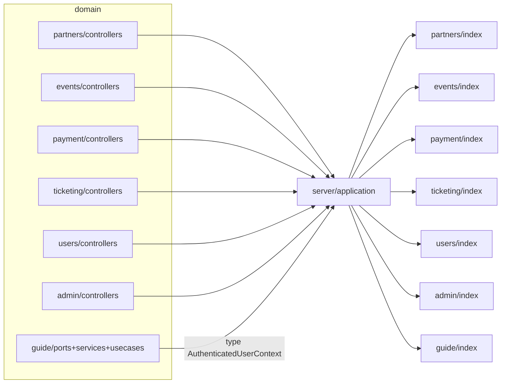
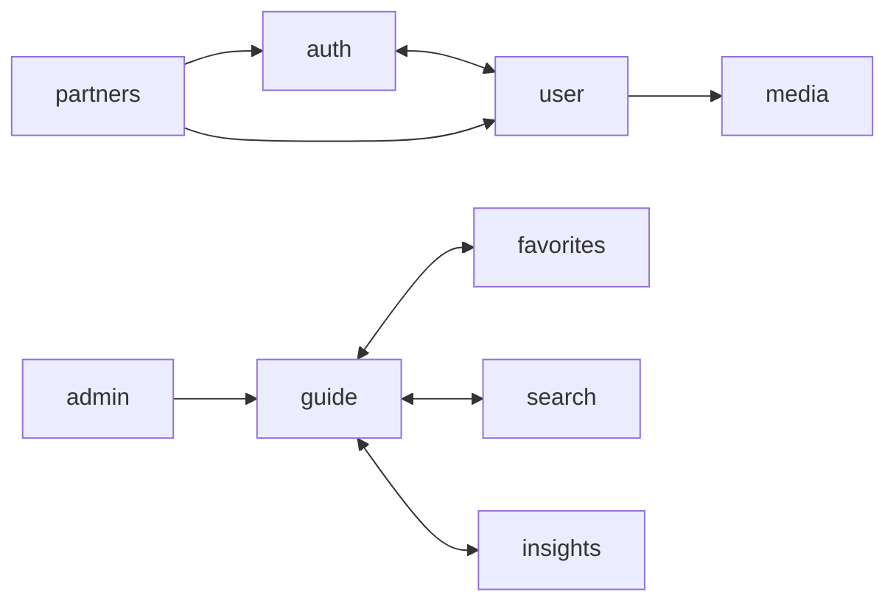
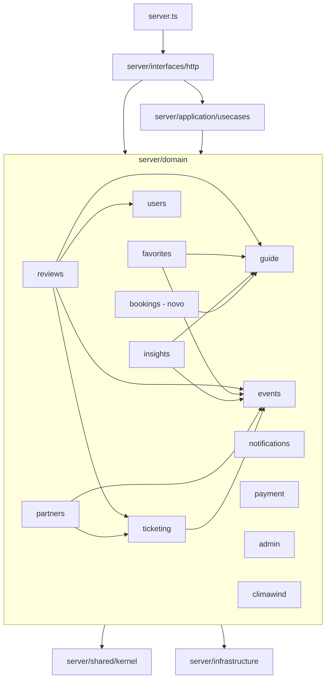

# Grafo de Dependências entre Domínios — Estado Atual (baseline)

> Gerado por análise estática de **todos** os `import`/`export ... from` de `server/`, `server.ts` e `src/` do zip `use-guide-main` (724 arquivos).
> Arestas contadas só em código de produção (`*.test.ts` separados). `import type` conta para o grafo **arquitetural**, mas não para ciclos de **runtime** (é apagado na compilação).
> Este documento é o pré-requisito obrigatório (AGENTS.md §5.4) antes de refatorar qualquer domínio.

---

## 1. Resumo executivo

| Verificação | Backend (`server/`) | Frontend (`src/`) |
|---|---|---|
| Ciclos de runtime entre **arquivos** | **0** ✅ | **2** ❌ (auth↔user; partners interno) |
| Ciclos diretos **domínio ↔ domínio** | **0** ✅ (é um DAG) | **4** ❌ auth↔user, guide↔favorites, guide↔search, guide↔insights |
| Ciclos **domínio ↔ camada** | **7** ❌ `domain/*` ↔ `application` | **8** ❌ `ui`/`shared` ↔ `domain/*` |
| Imports internos de outro domínio (sem passar por `index.ts`) | 1 | 30+ |

**Conclusão:** no backend, a lógica entre domínios já é acíclica; os ciclos existem porque **controllers que vivem dentro de `server/domain/*` importam `server/application/*`**, que por sua vez importa os domínios. É um problema de **posição de arquivo/camada**, resolvido movendo controllers orquestradores para `server/interfaces/http/` e o tipo `AuthenticatedUserContext` para `server/shared/kernel/`. No frontend, os ciclos são reais (de responsabilidade) e exigem composição em `src/app`.

---

## 2. Backend

### 2.1. Dependências diretas domínio → domínio (via `index.ts`, produção)

| De | Para | Arquivo(s) de origem | Observação |
|---|---|---|---|
| favorites | events | `services/favoriteService.ts` | OK (UseCase público) |
| favorites | guide | `services/favoriteService.ts`, `dtos/FavoriteDTO.ts` | OK |
| insights | events, guide | `services/insightsService.ts` | OK |
| notifications | partners | `services/notificationService.ts` | ⚠️ notifications deveria ser folha (§5.4) |
| partners | events | `controllers/partnerContentController.ts` | OK via index |
| partners | **events/schemas/eventSchema** | `schemas/partnerContentSchema.ts` | ❌ import de schema **interno** |
| partners | ticketing | `controllers/partnerContentController.ts` | OK via index |
| reviews | events, guide, users | `adapters/firestoreReviewAdapter.ts` | ⚠️ adapter chamando outro domínio (ACL); aceitável, mas mover para port dedicada |
| reviews | notifications | `adapters/reviewNotificationAdapter.ts` | OK (port + adapter = anti-corruption layer) |
| reviews | ticketing | `services/reviewService.ts` | OK (verificação de compra) |
| ticketing | events | `services/ticketingService.ts` | OK |
| bookings | guide | `adapters/guideBookableItemLookupAdapter.ts` | OK (port `BookableItemLookupPort`; guide não importa bookings; prompt 11) |

### 2.2. Dependências indiretas (fecho transitivo, só domínios)

| Domínio | Diretas | Indiretas |
|---|---|---|
| reviews | events, guide, notifications, ticketing, users | **partners** (via notifications) |
| notifications | partners | **events, ticketing** (via partners) |
| partners | events, ticketing | — |
| favorites | events, guide | — |
| insights | events, guide | — |
| ticketing | events | — |
| bookings | guide | — |
| events, guide, users, admin, payment, climawind, seo | — | — (folhas) |

### 2.3. Camada `server/application` (Composition UseCases)

| Application UseCase | Domínios orquestrados |
|---|---|
| `registerPartnerApplicationUseCase` | partners, users |
| `verifyPartnerApplicationUseCase` | partners, guide, events |
| `activatePartnerTrialApplicationUseCase` | partners, guide, events |
| `checkExpiringPartnerPlansApplicationUseCase` | partners, notifications |
| `create/update/deletePartnerItemApplicationUseCase` | partners, guide |
| `create/update/deletePartnerEventApplicationUseCase` | partners, events, guide |
| `renderSeoPageApplicationUseCase`, `renderSitemapApplicationUseCase` | seo, guide, events (seo continua folha: recebe o catálogo pelo `SeoContentPort`; prompt 8) |
| `startPartnerPlanSubscriptionApplicationUseCase`, `reconcilePlanSubscriptionWebhookApplicationUseCase` | admin, partners, payment, notifications (payment continua folha: só recebe IDs e valores; prompt 9) |
| `bookings/createBooking…`, `cancelBookingByBuyer…`, `cancelSlotByPartner…`, `reconcileBookingWebhook…` | bookings, payment, notifications (bookings não importa payment; payment só vê `referenceType`/`referenceId`; prompts 12 e 14) |
| `seo/catalogSeoContentProvider` | seo, guide, events, bookings (resumo da oferta no JSON-LD; prompt 14) |
| `eventLifecycleOrchestrationUseCases` | events, ticketing, notifications |
| `ticketingPaymentOrchestrationUseCases` | ticketing, payment, partners, events, notifications |
| `getPlanForPaymentApplicationUseCase` | admin |
| `getAdminStatsApplicationUseCase` | users, guide, events, reviews |
| `getAdminPartnersUseCase` | partners, users |
| `deleteUserAccountApplicationUseCase` | users, partners, guide, events, reviews |
| `resolveGuideUserContextApplicationUseCase` | users |

### 2.4. Ciclos domínio ↔ application (todos ❌)



| Ciclo | Arquivo que fecha o ciclo | Correção |
|---|---|---|
| partners ↔ application | `partners/controllers/partnerController.ts`, `partnerContentController.ts` | mover para `server/interfaces/http/partners/` |
| events ↔ application | `events/controllers/eventsController.ts` | mover para `server/interfaces/http/events/` |
| payment ↔ application | `payment/controllers/paymentController.ts` | mover para `server/interfaces/http/payment/` |
| ticketing ↔ application | `ticketing/controllers/ticketingController.ts` | mover para `server/interfaces/http/ticketing/` |
| users ↔ application | `users/controllers/userController.ts` | mover para `server/interfaces/http/users/` |
| admin ↔ application | `admin/controllers/adminStatsController.ts`, `adminPartnersController.ts` | mover para `server/interfaces/http/admin/` |
| guide ↔ application | `guide/ports/userContextResolverPort.ts`, `services/guideService.ts`, `usecases/{create,update,delete}GuideItemUseCase.ts` (só `import type`) | mover `AuthenticatedUserContext` para `server/shared/kernel/authenticatedUserContext.ts` |
| infrastructure → application | `infrastructure/auth/guideContextMiddleware.ts`, `authenticatedRequest.ts` | middleware vai para `server/interfaces/http/middlewares/`; tipo para o kernel |

### 2.5. Dependências temporárias / fora do padrão (registrar em `debitos.md`)

| # | Dependência | Regra violada | Risco | Correção definitiva |
|---|---|---|---|---|
| B1 | `partners/schemas/partnerContentSchema.ts` → `events/schemas/eventSchema.ts` | §5.2 (schema interno) | médio — mudança em events quebra partners | events exporta schema/tipo público de entrada, ou mover rotas de evento do parceiro para `interfaces/http` usando o schema de events |
| B2 | controllers de 6 domínios → `server/application` | §3.4 | baixo em runtime, alto em manutenção | mover para `server/interfaces/http` |
| B3 | `guide/*` → `application/security` (type) | §3.4 | baixo | `server/shared/kernel` |
| B4 | `notifications` → `partners` | §5.4 (notifications folha) | médio — cria cadeia reviews→notifications→partners→ticketing | receber `recipientPartnerId` já resolvido por parâmetro/Application UseCase |
| B5 | `reviews/adapters/firestoreReviewAdapter.ts` → guide/events/users | §3.1 (adapter de persistência com lógica cross-domain) | médio | separar `ReviewTargetPort` + adapter ACL dedicado |
| B6 | ~~`scripts/backfillPartnerDocumentKeys.ts` → `partners/services/backfillPartnerDocumentKeys.ts`~~ | §5.2 | — | **resolvido**: script removido (prompt 4.1) |
| B7 | ~~`adminClient.ts` lança erro na importação~~ | §2.2.4, §5.7 | — | **resolvido** no prompt 4 (factories de domínio ainda instanciam adapters na importação, mas sem I/O nem leitura de segredo) |
| B8 | ~~idempotência do webhook duplicada~~ | §8.6 | — | **resolvido** no prompt 2 |

---

## 3. Frontend

### 3.1. Dependências diretas domínio → domínio (produção)

| De | Para | Via `index.ts`? | Arquivos críticos |
|---|---|---|---|
| admin | auth | ❌ `auth/context/AuthContext`, `auth/types` | `AdminDispatcher.tsx`, `AdminPanel.tsx` |
| admin | guide, events, notifications, search, ticketing, media, database | ✅ | — |
| admin | partners | ⚠️ `partners/utils/dateTime` interno | `AdminEditorEventFields.tsx` |
| auth | **user** | ❌ `user/application/usecases/*`, `user/types` | `hooks/useAuth.ts`, `context/AuthContext.tsx`, `stores/useAuthStore.ts` |
| user | **auth** | misto | `ChangePasswordView`, `MainMenuView`, `useUserProfile`, `userSchema.ts`, `updatePasswordUseCase`, `deleteCurrentUserUseCase` |
| content | auth (❌ context), notifications | — | `AboutView.tsx` |
| favorites | auth, database (❌ `database/factory`), **guide** | — | `FavoritesList.tsx`, `FavoriteButton.tsx` |
| guide | **favorites** (❌ `components/FavoriteButton`) | ❌ | 7 modais de detalhe |
| guide | **insights**, **reviews**, **search**, ticketing | ✅ | modais de detalhe, `ExploreView.tsx` |
| guide | climawind (❌ `components/LiveConditions`) | ❌ | `ExploreView.tsx` |
| guide | auth (❌ context) | ❌ | `EventDetailModal.tsx` |
| insights | auth, database, **guide**, reviews | ✅ | `ReportsView.tsx`, `trackInteractionUseCase.ts` |
| search | **guide** | ✅ | `types/search.ts`, `ports/searchPort.ts`, hooks, adapter |
| partners | auth, database, guide, media, user | ✅ | 7 hooks |
| reviews | auth (❌ context), database (❌ `database/ports/databasePort`) | misto | `ReviewSection.tsx`, `reviewPort.ts` |
| ticketing | auth (❌ context), events, payment | misto | componentes de compra |

### 3.2. Ciclos de domínio (❌)



| Ciclo | Causa | Correção recomendada |
|---|---|---|
| **auth ↔ user** (também ciclo de runtime: `LoginModal → auth/index → useAuth → updateCurrentUserUseCase → userSchema → auth/index`) | `auth` busca o perfil do usuário; `user` usa a sessão de `auth` | `auth` vira folha (só sessão/token). Composição da "sessão + perfil" em `src/app/session` ou `user` depende de `auth` e nunca o contrário |
| **guide ↔ favorites** | modais do guide embutem `FavoriteButton`; `FavoritesList` renderiza cards do guide | modais recebem `actions` por slot/props a partir de `src/app/compositions/ItemDetailComposition.tsx` |
| **guide ↔ search** | `ExploreView` (guide) usa `SearchOverlay`; search usa tipos do guide | search depende de guide (dados); a tela que junta os dois vai para `src/app` |
| **guide ↔ insights** | modais disparam `trackInteraction`; `ReportsView` lê itens do guide | tracking via composição/evento de UI; insights depende de guide |

### 3.3. Ciclos domínio ↔ camadas compartilhadas (❌)

| Camada | Importa | Arquivo | Correção |
|---|---|---|---|
| `src/ui/layouts/Header.tsx`, `SideMenu.tsx` | auth (context), user, ticketing, content | layout conhece domínio | receber usuário/itens de menu por props; montar em `src/app` |
| `src/ui/components/ShareButton.tsx` | insights | — | callback `onShared` |
| `src/shared/stores/useFavoritesStore.ts` | favorites, insights | store de domínio em `shared` | mover para `src/domain/favorites/stores` |
| `src/shared/lib/insights.ts` | insights | — | mover para `src/domain/insights` |
| `src/shared/utils/operatingHoursStatus.ts` | guide | regra de domínio em `shared` | mover para `src/domain/guide/utils` |

### 3.4. Ciclo interno de runtime (partners)

`PartnerPanel.tsx → usePartnerPanelActions → usePartnerContentActions → usePartnerItems → partners/index.ts → PartnerPanel.tsx`: hooks importam o barrel do próprio domínio. Regra: **dentro do domínio, importar por caminho relativo, nunca o próprio `index.ts`.**

---

## 4. Direção arquitetural desejada

### 4.1. Backend (alvo)



Invariantes: `payment`, `notifications`, `users`, `admin`, `events`, `guide` são folhas; nenhuma seta sai de `domain` para `application`/`interfaces`.

### 4.2. Frontend (alvo)

```
src/app (router + compositions)  →  src/domain/*  →  src/ui, src/shared
auth (folha) ← user ← partners/admin
guide (folha de dados) ← search, favorites, insights, reviews(alvo por id)
payment (folha) ← ticketing, bookings
```

---

## 5. Ordem de refatoração recomendada (menor risco primeiro)

1. **P0** — Corrigir webhook Stripe (B8) e inicialização lazy (B7). Bugs de produção, independem da reorganização.
2. **Backend camadas** — criar `server/shared/kernel` (B3) → mover controllers orquestradores para `server/interfaces/http` (B2). Só movimentação de arquivos + imports; zero mudança de comportamento.
3. **Backend domínio** — B1, B4, B5, B6.
4. **Frontend** — quebrar `auth ↔ user` (ciclo de runtime) → tirar domínio de `ui/shared` → compositions para guide↔favorites/search/insights.
5. **Novo domínio `bookings`** — só depois do grafo limpo.

## 6. Como reexecutar a análise

Após cada refatoração, reexecutar e anexar o resultado ao PR (critério: 0 ciclos):

```bash
npx madge --circular --extensions ts,tsx server server.ts
npx madge --circular --extensions ts,tsx src
```

Recomendado adicionar regras de fronteira automáticas (ex: `dependency-cruiser` no CI) com: proibir `server/domain/** → server/application/**`, `src/(ui|shared)/** → src/domain/**` e imports de outro domínio que não terminem em `index.ts`.
